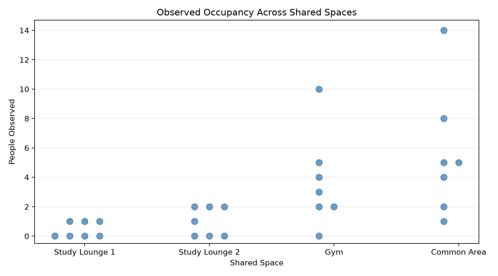
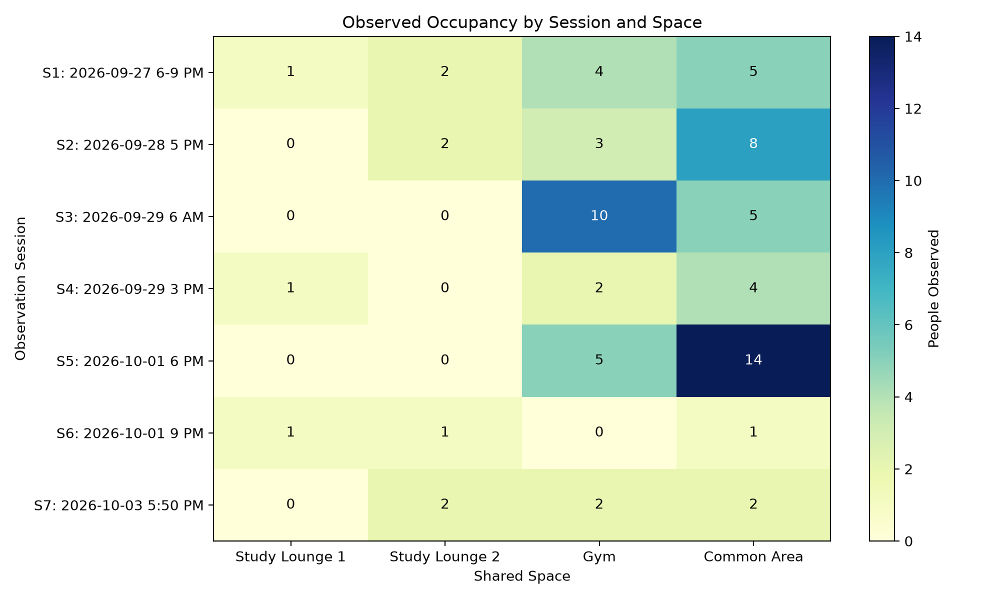
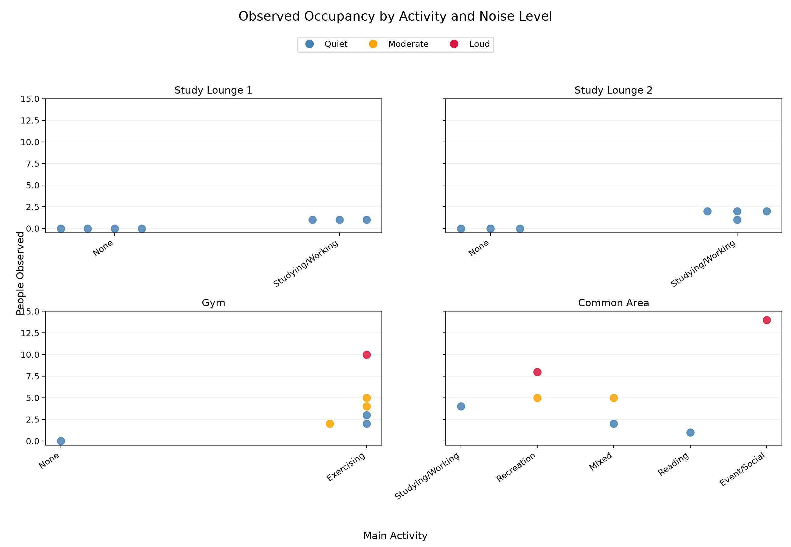
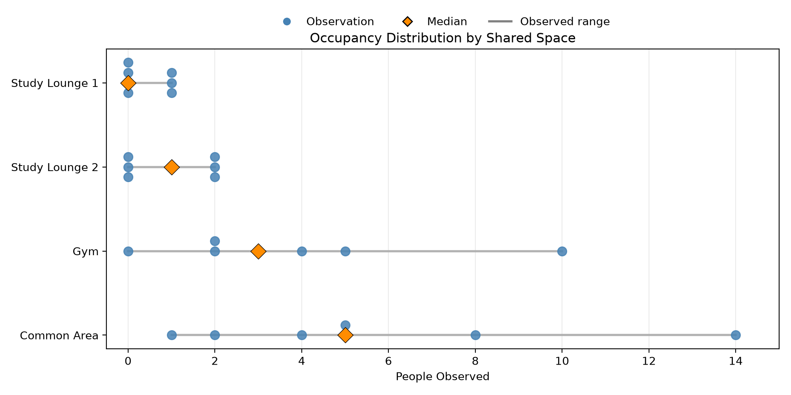
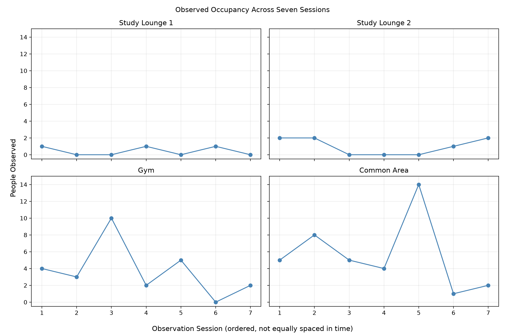
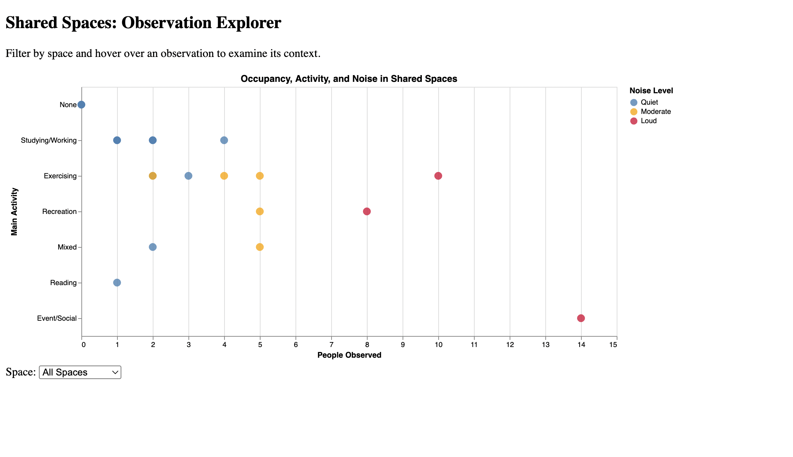
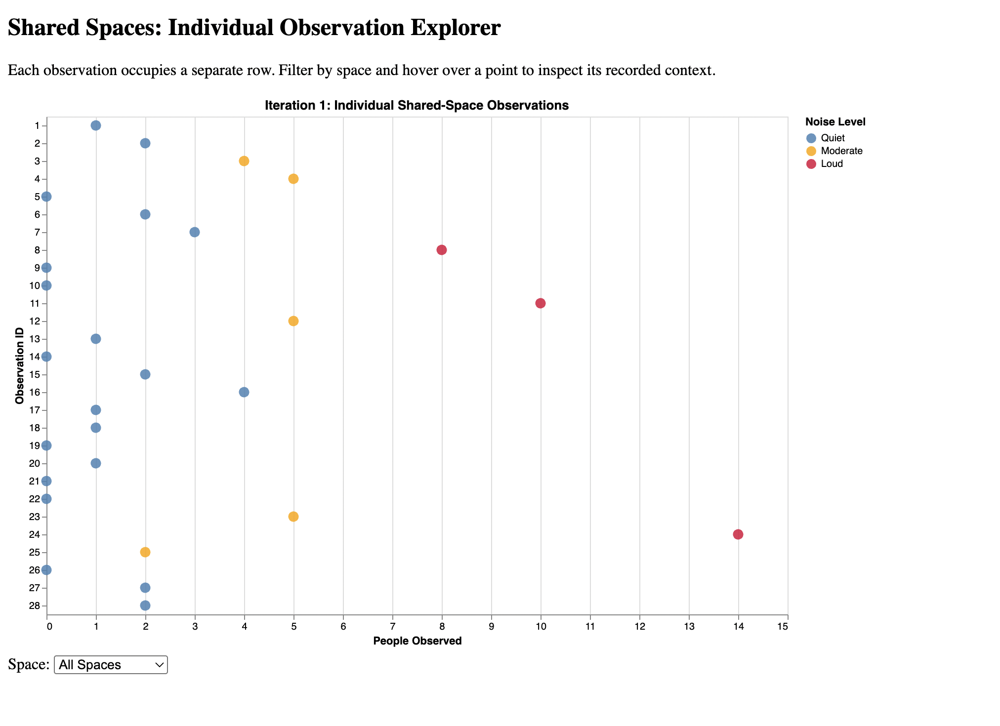
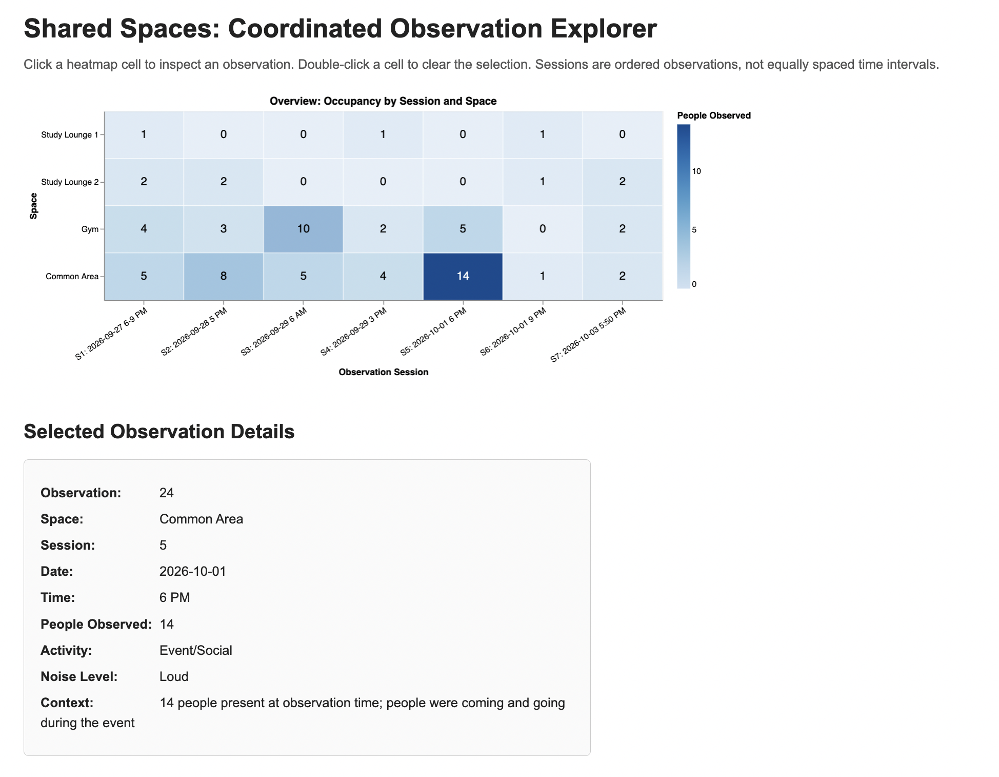

# CS 424 Assignment 2

## Exploring and Building Visualizations

## Task 1: Revisit Data and Questions

I continued with my Assignment 1 dataset: 28 observations of four shared spaces across seven sessions. I checked it for duplicates, missing values, and inconsistencies. I kept `None` as the activity for empty spaces (it is not missing data) and left the September 27 time as `6-9 PM` because I never recorded an exact time.

My original plan was to compare occupancy by time of day, but five of the seven sessions were in the evening, with one morning and one afternoon session. That is not enough for a meaningful comparison, so I shifted to these questions:

1. How does occupancy differ across the four spaces?
2. Which spaces vary the most between sessions?
3. How do activity and noise level relate to occupancy?
4. Which observations stand out, and what was happening during them?

The results describe only the sessions I collected, not typical occupancy.

## Task 2: Data Transformation

`scripts/prepare_data.py` reads `data/shared_spaces.csv` and writes `data/processed/shared_spaces_processed.csv`. It checks for duplicate IDs, invalid dates, negative counts, and whether every session includes all four spaces, strips extra whitespace, and preserves `None` in `main_activity`.

It adds `session_id` (1–7) and `session_label` (session number, date, recorded time) so observations from the same visit can be grouped. Sessions are numbered chronologically because the observation IDs for the October 1 sessions are not in time order. The original CSV is unchanged.

## Task 3: Explore the Data

**Occupancy by space.**

Study Lounge 1 stayed between 0 and 1 person, while Study Lounge 2 ranged from 0 to 2. The Gym reached 10 people and the Common Area reached 14. Small differences within the lounges were hard to see on a shared scale, and the spaces differ in size, so the counts do not directly indicate how full each space was.

**Occupancy by session.**

The heatmap made two counts stand out: the Gym with 10 on September 29 at 6 AM and the Common Area with 14 during the October 1 event. The same Common Area had 1 person later that day. The Gym's count of 10 comes from the only morning session, so I can't say the Gym is generally busier in the morning.

**Activity and noise.**

Both lounges were recorded as Quiet, while the Gym and Common Area included noise levels ranging from Quiet to Loud, with their highest counts both labeled Loud. My first version had stacked points and a cut-off y-axis, so I fixed the scale and offset repeated points. Activity is tied to the space (exercise was recorded in the Gym), so comparing activities without considering the space isn't very useful.

This showed me I needed both an overview of counts and a way to see the context behind individual observations.

## Task 4: Alternative Visualization Designs

**Direction A: Occupancy distribution by space.**

This supports comparing how much each space varies. It uses `space` and `people_count`: position for count, circles for observations, diamonds for medians, and gray lines for ranges. It makes the wider Gym and Common Area ranges obvious, but it can't show which session or activity a count came from. I kept it as a summary view only.

**Direction B: Occupancy across sessions.**

This supports following each space across sessions. It uses `session_id`, `space`, and `people_count` in four small line charts using the same y-axis scale. The counts of 10 and 14 are easy to spot, but the lines suggest continuous change between sessions I never measured, so I dropped the lines and kept the session comparison idea.

**Direction C: Interactive observation explorer.**

[Open Direction C](https://adhvetha0304.github.io/CS424_Assignment1/assignment2/visualization/alternative_c.html)

This supports inspecting individual observations. It uses `people_count` (x), `main_activity` (y), and `noise_level` (color) in a Vega-Lite scatterplot, with a space dropdown and tooltips for date, time, and notes. The tooltips worked well, but observations with the same count and activity landed on the same point, so some records could not be inspected separately. I continued with this direction because I wanted to keep the details-on-demand interaction.

## Task 5: Interaction and Multiple Views

Direction C used a dropdown to focus on one space and tooltips to keep details off the chart. The final design pairs a heatmap with an HTML details panel. Clicking a cell shows that observation's date, time, count, activity, noise level, and notes, and double-clicking clears the selection.

The two views belong together because the heatmap is for comparing counts and the panel is for checking what happened behind a count. I tested it by selecting the Common Area cell in Session 5, which displayed Observation 24 with 14 people and the October 1 event notes. I also selected the Gym in Session 3 and checked that the panel changed to the 10-person observation from September 29.

## Task 6: Iterate and Refine

### Iteration 1: Separating Overlapping Observations

[Open Iteration 1](https://adhvetha0304.github.io/CS424_Assignment1/assignment2/visualization/iteration1.html)

**Problem:** Observations with the same activity and count overlapped in the scatterplot.

**Change:** I replaced activity on the y-axis with observation ID, so each observation got its own row. I kept the noise colors, space filter, and tooltips.

**Result:** All 28 observations were visible, but a list of 28 IDs made it hard to compare spaces or sessions. Separating the points wasn't enough.

### Iteration 2: Overview Plus Details

[Open Iteration 2](https://adhvetha0304.github.io/CS424_Assignment1/assignment2/visualization/iteration2.html)

**Problem:** The scatterplot wasn't supporting the session-by-space comparison I wanted.

**Change:** I returned to the session-by-space heatmap from my EDA and Assignment 1 sketch, with the count shown as both a number and color intensity. I linked it to a details panel, labeled sessions with their dates and times, and adjusted text colors for readability.

**Result:** I can compare all 28 counts in one view and still inspect individual records without losing the context behind each observation.

## Task 7: Current Design

My current design is the heatmap with a linked details panel from Iteration 2.

[Open the current working visualization](https://adhvetha0304.github.io/CS424_Assignment1/assignment2/visualization/iteration2.html)

It supports comparing spaces, seeing variation between sessions, and finding unusual observations and their context (Questions 1, 2, and 4). The main decision was to let color represent occupancy only and move noise and activity into the details panel. My Assignment 1 sketch encoded noise with color and shape, and the sketch was static, while this version is interactive.

For comparing spaces and spotting unusual counts, it is the clearest version I tried. I'm still unsure about Question 3: activity and noise aren't visible together in the overview, so someone has to click through observations. For Assignment 3, I want to test whether another person can compare the spaces, find an unusual count, and understand its context without much explanation, and whether a separate activity and noise view would help.

With seven sessions and uneven time coverage, I would keep conclusions limited to what I collected.
