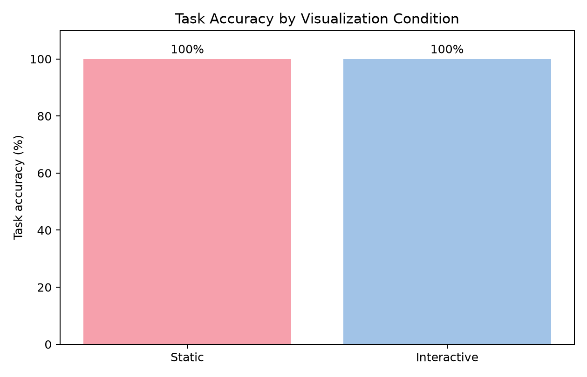
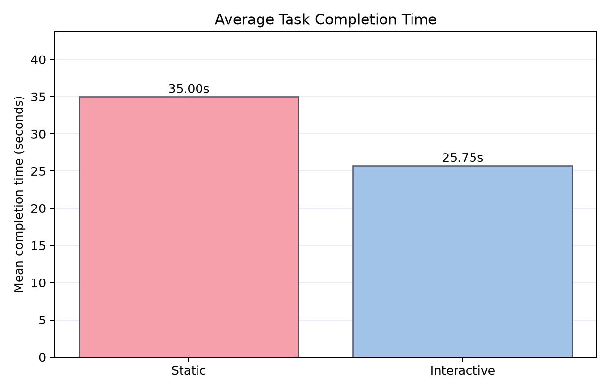
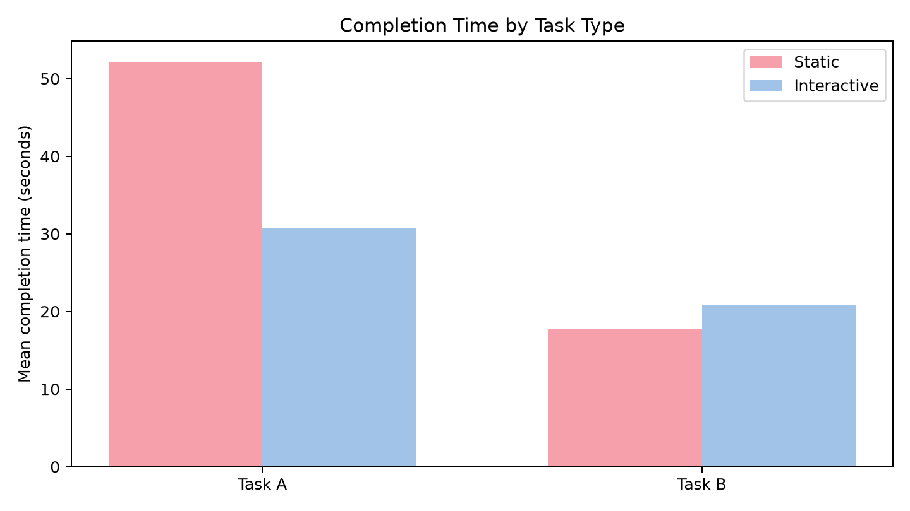

# CS 424 Assignment 3: Interaction and Evaluation

## Task 1: Implementing Interaction

For this assignment, I extended the shared-space occupancy visualization from Assignment 2 to investigate whether interaction makes it easier to answer analytical questions. The dataset contains 28 observations across four shared spaces (Study Lounge 1, Study Lounge 2, Gym, and Common Area) and seven observation sessions.

I compared two versions of the same occupancy heatmap:

- **Static visualization:** Shows occupancy counts by space and session using a heatmap. A reference table below the chart provides noise levels, activities, dates, times, and other observation details.
- **Interactive visualization:** Uses the same heatmap and occupancy color scale, but allows users to select a space and noise level to highlight matching sessions. Users can also click cells to inspect observation details and double-click to clear a selection.

The static version retains all the information needed to answer the questions. I included the reference table so that participants could check noise levels without depending on interactive controls. Both versions use the same underlying observations.

I expected the noise highlighting to be particularly useful when a question required identifying sessions that satisfied a noise condition before comparing occupancy. I did not expect interaction to be equally helpful for simple occupancy comparisons, where the required counts were already visible.

**Working visualizations:**

- [Static visualization](https://adhvetha0304.github.io/CS424_Assignment1/assignment3/visualization/static.html)
- [Interactive visualization](https://adhvetha0304.github.io/CS424_Assignment1/assignment3/visualization/interactive.html)

The implementations and generation scripts are available in the `visualization/` directory and the `build_static.py` and `build_interactive.py` files.

## Task 2: Evaluation Design

My evaluation question was:

**Does an interactive heatmap with noise highlighting and observation details help people answer comparison questions faster or more accurately than a static heatmap with a reference table?**

I developed two hypotheses:

- **H1:** Participants will complete noise-and-occupancy questions (Task A) faster with the interactive version because highlighting reduces the effort required to identify relevant sessions.
- **H2:** Completion times for occupancy-change questions (Task B) will be similar between versions because the heatmap already displays the necessary counts.

I used a within-subject design, with each participant completing two questions using Static and two using Interactive. Each task had two variants to reduce direct answer memorization.

### Analytical Tasks

| Variant | Analytical question | Expected answer |
|---|---|---|
| A1 | Among sessions where the Gym was Quiet, identify the session with the highest combined Gym and Common Area occupancy. | Session 2, 11 people |
| A2 | Among sessions where the Common Area was Quiet, identify the session with the highest combined Gym and Common Area occupancy. | Session 4, 6 people |
| B1 | Between Sessions 1 and 3, identify the space with the largest absolute occupancy change. | Gym, 6 people |
| B2 | Between Sessions 2 and 5, identify the space with the largest absolute occupancy change. | Common Area, 6 people |

Task A required checking noise conditions, combining occupancy counts, and comparing qualifying sessions. Task B required comparing changes across four spaces. Neither task could be completed by simply identifying one isolated value.

Five participants used Static first and five used Interactive first. Each question variant appeared five times in each condition. Task A was always presented before Task B within each condition.

I measured **task accuracy** and **completion time in seconds**. For Task A, a response was correct only when both the session and combined count were correct. For Task B, both the space and absolute change had to be correct. The time limit was 120 seconds per question. Incorrect or incomplete answers received accuracy 0; a timeout would also be recorded as 120 seconds with accuracy 0.

The full question wording, condition schedule, participant instructions, and scoring procedure are documented in [the evaluation protocol](study/protocol.md).

## Task 3: Conducting the Evaluation

### Pilot Evaluation

I conducted a pilot on November 14, 2026, with one participant who was excluded from the main study. The pilot participant completed three of four questions correctly, with a mean completion time of 27 seconds.

During the Static A1 question, the participant selected Session 5 with 19 people. Although that was a high combined occupancy, the session did not meet the Gym's Quiet condition. The participant also reported that the static page initially felt confusing and mainly used the heatmap rather than the reference table.

Based on this observation, I added a short explanation to the static visualization describing what the heatmap and reference table showed. I regenerated the main and practice static pages. The analytical questions, scoring criteria, underlying data, and interactive functionality were not changed.

The final materials were verified and frozen on November 15, before the main study began. The pilot results and decisions are documented in [the pilot notes](study/pilot_notes.md).

### Main Study

I evaluated the visualizations with 10 participants: six classified themselves as beginners and four as intermediate in chart familiarity. Every participant completed four timed questions, giving 40 individual task records.

Before the timed questions, participants received the same instructions and practiced using separate synthetic data. Practice included reading the static reference table and using the interactive highlighting and cell-selection controls. Practice was not timed.

Participants then completed their assigned questions. Timing started when the visualization and question were visible and stopped when they provided their final answer. I recorded their answers, times, and relevant observations without using names in the dataset.

Five participants started with Static and five with Interactive. Each condition contained 20 completed tasks. Most recorded main-study sessions used my laptop; the device was not documented for two participants. These differences are considered in the limitations.

The individual measurements are preserved in [results.csv](study/results.csv). Each row identifies the anonymous participant, familiarity, presentation order, visualization condition, task variant, task position, recorded answer, correctness, completion time, timeout status, device, and notes.

## Task 4: Quantitative Analysis

I analyzed the 40 task records using Python's CSV and statistics modules and Matplotlib. The analysis script computes descriptive statistics by condition, task type, presentation order, and participant.

### Overall Performance

| Measure | Static | Interactive |
|---|---:|---:|
| Number of tasks | 20 | 20 |
| Correct responses | 20 | 20 |
| Accuracy | 100% | 100% |
| Mean completion time | 35.00 s | 25.75 s |
| Median completion time | 32.00 s | 25.00 s |
| Timeouts | 0 | 0 |

Both versions achieved 100% accuracy. Interaction therefore did not improve measured accuracy in the main study. The results may also reflect a ceiling effect because the questions were manageable after practice.

Interactive had a lower mean completion time by **9.25 seconds per task** overall, although the difference varied by task and participant.



*Figure 1. Accuracy was identical across conditions: 100% for both.*



*Figure 2. Interactive had a lower overall mean completion time.*

### Differences Between Task Types

| Task | Static mean | Interactive mean | Difference |
|---|---:|---:|---|
| A: Noise-constrained occupancy comparison | 52.20 s | 30.70 s | Interactive faster by 21.50 s |
| B: Occupancy-change comparison | 17.80 s | 20.80 s | Static faster by 3.00 s |



*Figure 3. Interaction was associated with a larger time improvement for Task A, while Static was slightly faster for Task B.*

**H1 was supported descriptively:** Task A was substantially faster with Interactive. Highlighting matching noise conditions provided a direct way to narrow the relevant sessions, while Static required participants to move between the reference table and heatmap.

**H2 was broadly consistent with the results:** Task B times were relatively close, although Static was three seconds faster on average. During the evaluation, I noticed that some participants hesitated over whether they were supposed to use the interactive dropdown controls for Task B. Those controls were not necessary for comparing the already-visible occupancy counts. This extra decision may have contributed to the longer interactive times.

### Differences Between Participants and Presentation Orders

Seven of the ten participants had a lower average task time with Interactive. However, this was not consistent across everyone. For example, P05 averaged 82.0 seconds with Static and 30.5 seconds with Interactive, while P06 averaged 23.5 seconds with Static and 45.0 seconds with Interactive.

Presentation order also showed a substantial difference:

| Presentation order | Static mean | Interactive mean |
|---|---:|---:|
| Static first | 43.40 s | 19.10 s |
| Interactive first | 26.60 s | 32.40 s |

In both groups, the condition completed second had the lower mean time. This suggests that participants may have become more familiar with the dataset and the question format as the evaluation progressed. Counterbalancing helped distribute this learning effect, but it does not eliminate it.

These results describe the ten participants in this study. I did not perform statistical significance testing, and the observed differences should not be interpreted as proof that interaction causes faster performance in general.

The reproducible analysis is available in [analyze_results.py](analysis/analyze_results.py), with numerical output in [summary.txt](analysis/summary.txt).

## Task 5: Reflection and Recommendations

The most useful finding was that interaction helped with some analytical tasks much more than others. For Task A, participants needed to identify sessions satisfying a noise condition before comparing occupancy. The interactive highlighting matched that need and reduced the amount of information participants had to search through manually.

The static version was still a meaningful alternative because its reference table contained the same noise information. However, some participants found it inconvenient to switch between the table and the heatmap. One participant specifically mentioned that moving back and forth between them felt confusing and time-consuming.

Task B showed the opposite pattern. Because the occupancy counts were already visible, the interactive controls did not add much analytical value. Some participants were unsure whether they should use the dropdowns, which may have added unnecessary effort. This was a useful reminder that interaction is not automatically beneficial.

Several participants said they preferred Interactive, but their preferences did not always correspond to faster completion times. I therefore treated their comments as usability observations rather than evidence of a universal performance advantage.

### Improvements I Would Make

First, I would make the static version easier to navigate by placing noise information closer to the corresponding heatmap cells, reducing the need to repeatedly switch between the chart and reference table.

Second, I would improve the interactive instructions so that it is clearer when the dropdowns are useful and when participants can simply read the heatmap. I would also consider making the currently selected filters more visually obvious.

Finally, I would explore a more direct way to compare occupancy between two sessions. Task B did not particularly benefit from the existing controls, so a comparison-focused interaction could be more useful than noise highlighting for that type of question.

### Limitations

The study included only 10 participants, with six beginners and four intermediate users. This small, convenience-based sample limits how broadly the results can be applied.

Participants also needed different amounts of time to become comfortable with the visualization and questions. Although I provided practice and counterbalanced the starting condition, the results still suggest learning and order effects. Task A always came before Task B within each condition, which could also influence task-level timing differences.

The question variants were designed to be comparable, but they were not necessarily identical in difficulty. Completion times were recorded manually, and one early time was reported approximately. All participants answered correctly, so this evaluation could not distinguish the designs through accuracy.

### Conclusion

In this evaluation, Interactive was faster overall, with its clearest advantage on noise-constrained Task A questions. Static was slightly faster on the simpler Task B comparisons, and both versions achieved the same accuracy.

The results suggest that interaction is most useful when it directly supports the analytical operation a person needs to perform. Adding controls without a clear purpose can create additional decisions rather than make a task easier. A larger study with more varied questions and tighter control over familiarization would help test these observations further.

## Reproducing the Work

The visualizations can be opened using the live links in Task 1, or regenerated from the repository root:

```bash
python assignment3/build_static.py
python assignment3/build_interactive.py
python assignment3/build_practice.py
```

To reproduce the numerical analysis and figures:

```bash
python assignment3/analysis/analyze_results.py
```

This reads `assignment3/study/results.csv` and generates the statistics and comparison charts in `assignment3/analysis/`. Matplotlib is needed to generate the figures.

The [evaluation protocol](study/protocol.md), [participant instructions](study/participant_instructions.md), [pilot notes](study/pilot_notes.md), and [individual study records](study/results.csv) provide the remaining materials needed to understand and reproduce the evaluation.
