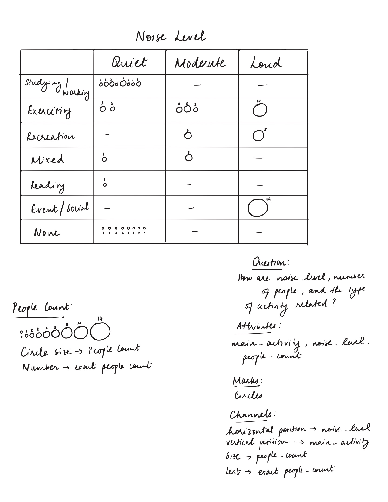

# CS 424 Assignment 1

## Occupancy and Usage Patterns Across Shared Apartment Spaces

## Task 1: Data Collection Plan
### Project Description

I chose to observe shared spaces in my apartment building because I spend a lot of time in the building and regularly use or pass through these areas. I had noticed that some spaces seemed much busier at certain times than others, which made me curious about how their usage changes throughout the day.

I focused on four shared spaces: Study Lounge 1, Study Lounge 2, the gym, and the common area. I wanted to observe how the number of people and the way these spaces are used vary depending on the location and time of day. Since the spaces have different purposes, I was also interested in comparing their noise levels and the main activities taking place in them.

### Initial Domain Questions

1. How does the number of people using each shared space vary by time of day?
2. Which shared spaces are used the most and least during the observed periods?
3. How does noise level vary across the different shared spaces?
4. What types of activities occur in each space, and how do they change across observation periods?

### Initial Collection Plan

I treated one observation as one snapshot of a shared space at a particular date and time. For each observation, I planned to record the space, date and time, number of people present, noise level, main activity, and any useful contextual notes. I planned to repeat this process across the same four spaces so that observations from different sessions could be compared consistently.

For noise level, I used three categories: Quiet, Moderate, and Loud. Quiet meant there was little or no noticeable conversation or background activity, Moderate meant there was noticeable background sound or normal activity, and Loud meant there was substantial conversation, recreation, or other sound. The main activity was based on what people in the space were primarily doing, such as studying/working, exercising, or recreation.

I chose these four spaces because they serve different purposes but are all shared areas available to residents. I planned to collect observations on multiple days and at different times depending on when I was available in the building. I also planned to include observations at different times of day to capture variation in usage. During each observation session, I planned to check the same four spaces so that usage could be compared across locations and times.

Because the observation times depended partly on when I was available in the building, the sample is a convenience sample rather than a balanced sample of all days and times. This could overrepresent the usage patterns that occur during the periods when I was most often available.

I completed the project individually, so I planned and carried out all observations myself.

I did not record names, faces, private conversations, or any other identifying information. I only recorded characteristics of the spaces and general activities. One limitation of this method is that each observation is only a snapshot, so it does not show how long people stayed in a space. The spaces also differ in size, so comparing people counts does not necessarily represent the same level of occupancy in every space. Since I collected the observations by myself, noise level and main activity also depended on my own judgment.

### Initial Data Dictionary

| Attribute | Type | Description | Example |
|---|---|---|---|
| observation_id | Identifier | Unique number for each observation | 1 |
| date | Temporal | Date of the observation | 2026-09-27 |
| day_of_week | Categorical | Day of the observation | Sunday |
| time | Temporal | Recorded time or time range of the observation | 6-9 PM |
| time_period | Ordinal/Categorical | General period of day: Morning before 12:00 PM; Afternoon 12:00–4:59 PM; Evening 5:00 PM or later | Evening |
| space | Categorical | Shared space being observed | Study Lounge 1 |
| space_type | Categorical | General purpose of the space | Study |
| people_count | Quantitative | Number of people observed | 5 |
| noise_level | Ordinal | Observed noise category | Loud |
| main_activity | Categorical | Main activity occurring in the space | Studying/Working |
| context_notes | Text | Additional relevant details | People playing table tennis |

## Task 2: Pilot Collection and Revision

### Pilot Collection

I used my first two observation sessions, totaling eight observations across the four spaces, as the pilot for the collection process. These early observations helped me see whether the attributes I had chosen were practical to record and what needed to be more consistent. I continued using these observations in the final dataset because they were still compatible with the revised collection method.

One issue I noticed from my first session was the way I recorded time. For the September 27 observations, I only recorded that the observations took place sometime between 6 and 9 PM rather than recording the specific time. After this first session, I realized that a more precise time would be more useful for comparing observations, so I recorded specific observation times in later sessions.

The people count, noise level, and main activity were generally easy to record because they could be observed directly during each visit. However, some spaces could have more than one activity occurring at the same time. For example, the common area could have people working while others were waiting for coffee or doing something recreational. Because of this, I allowed the main activity to be recorded as Mixed when there was not one clear activity representing the space.

Context also became useful during collection. Some observations took place under conditions that could be relevant when interpreting the data, such as heavy rain or an event in the main lobby. I kept these details in `context_notes` rather than assuming that they caused the observed differences.

As the dataset developed, I also refined the domain questions to better match the variation captured by the observations. The initial questions emphasized time of day, while the final questions broaden this focus to comparisons across spaces and sessions, relationships among occupancy, noise and activity, and observations that stand out from typical usage. This made the final questions better match the variation I had actually collected without going beyond what the observations could support.

### Revisions to the Collection Procedure

After the early observations, I made the collection procedure more consistent. I recorded a more specific time whenever possible, continued using the same noise categories across spaces, used None for the main activity when a space was empty, and used Mixed when multiple activities were occurring without one clear dominant activity. I also kept contextual information separate from the main activity so that unusual conditions could be documented without treating them as explanations for the observations.

During collection, I considered whether people counts needed to distinguish between exact and estimated values. In the final dataset, each `people_count` represents the number of people present at the observation snapshot, including the event observation. Because all final counts use the same measurement approach, a separate `count_type` attribute was unnecessary and was not retained in the final schema.

During final dataset cleanup, I compared the structured CSV with my original observation notes and corrected transcription inconsistencies. I only changed an entry when the value was clearly recorded in my notes rather than inferring it afterward. While reviewing the notes, I confirmed that the September 27 Common Area noise level was Moderate, filled in noise values that had been left unresolved in the earlier CSV draft, and verified that the October 1 event observation was an exact snapshot count of 14, even though people were entering and leaving during the event.

The revised procedure still treated one observation as one snapshot of one space. During each observation session, I checked the same four spaces and recorded the people count, noise level, main activity, and any relevant context.

### Revised Data Dictionary

| Attribute | Type | Description | Example |
|---|---|---|---|
| observation_id | Identifier | Unique number for each observation | 1 |
| date | Temporal | Date of the observation | 2026-09-27 |
| day_of_week | Categorical | Day of the observation | Sunday |
| time | Temporal | Recorded time or approximate time range | 5:50 PM |
| time_period | Ordinal/Categorical | General period of day: Morning before 12:00 PM; Afternoon 12:00–4:59 PM; Evening 5:00 PM or later | Evening |
| space | Categorical | Shared space being observed | Common Area |
| space_type | Categorical | General purpose of the space | Social/Common |
| people_count | Quantitative | Number of people present at the observation time | 14 |
| noise_level | Ordinal | Observed noise level: Quiet, Moderate, or Loud | Moderate |
| main_activity | Categorical | Main activity: Studying/Working, Exercising, Recreation, Reading, Event/Social, Mixed, or None | Mixed |
| context_notes | Text | Additional conditions or details useful for interpreting the observation | Heavy rain outside |

## Task 3: Final Dataset and Domain Questions

### Final Dataset

My final dataset contains 28 observations collected across five dates and seven observation sessions. During each session, I observed the same four spaces: Study Lounge 1, Study Lounge 2, the gym, and the common area. The observations cover morning, afternoon, and evening periods as well as both weekdays and weekends.

The final machine-readable dataset is available in [`shared_spaces.csv`](shared_spaces.csv).

The dataset includes information about the number of people present, noise level, main activity, location, date and time, and relevant context. The observations provide variation across both space and time. Evening observations are more heavily represented in the dataset, so comparisons across time periods should be interpreted within the scope of the collected observations rather than as general usage patterns for the building.

The spaces also differ in size and capacity, but I did not have a reliable, comparable capacity measure for every space, particularly the gym. Because of this, I used the observed number of people rather than occupancy percentages. Comparisons should therefore be interpreted as differences in raw usage counts rather than differences in how full each space was.

The temporal coverage is uneven. Of the 28 observations, 20 were collected during evening sessions, while morning and afternoon are represented by only one session each. Weekend observations account for 8 of the 28 observations across two sessions. The dataset also covers only five dates, so conditions occurring on individual dates, such as the event or heavy rain, can have a noticeable influence on such a small sample. All observations were collected by one observer, and `noise_level` and `main_activity` were based on observational judgment rather than instrument measurements. In addition, each record represents only a snapshot, so the dataset does not show how long people remained in a space or what happened continuously between observation times.

### Reflection on the Data

Turning the observations into structured data required simplifying what was happening in each space. People count was straightforward, but activity and noise sometimes required judgment. A space could also have multiple activities happening at once, which is why I added Mixed as an activity category. I used context notes for information such as the event and heavy rain because these details could provide useful context when interpreting an unusual observation, without assuming that they caused the differences I observed.

Representing each visit as a snapshot necessarily abstracts away information between observation times, such as how long individuals remained in a space, whether they arrived as groups, and how usage changed continuously between snapshots. These details are therefore outside the scope of the dataset rather than inferred from the recorded observations.

Overall, converting the observations into a structured dataset helped me identify which attributes could be recorded consistently and which required more judgment.

### Revised Domain Questions

1. **Which shared spaces have the highest and lowest overall observed usage across all sessions?**  
   This uses `space` and `people_count` to compare the overall distribution and extremes of observed usage across the four spaces.

2. **Within each shared space, how much does `people_count` vary from one observation session to another?**  
   This uses `space`, `date`, `time`, and `people_count` to examine within-space variation across sessions and identify spaces with relatively stable or changing usage.

3. **How are noise level, number of people, and the type of activity related?**  
   This uses `noise_level`, `people_count`, and `main_activity`. For example, similar numbers of people may produce different noise levels depending on what they are doing.

4. **Which shared spaces show more consistent activity patterns, and which are used for a wider variety of activities?**  
   This uses `space` and `main_activity` to compare the distribution and variety of activities observed in each space.

5. **Which individual observations stand out from the usual usage of each space?**  
   This uses `space`, `people_count`, `noise_level`, and `context_notes` to identify unusual observations while keeping contextual conditions separate from causal conclusions.

## Task 4: Abstract Tasks

For each domain question, I translated the question into actions and targets. The actions describe what someone needs to accomplish using the visualization, while the targets describe the aspects of the data that are relevant to that goal.

1. **Which shared spaces have the highest and lowest overall observed usage across all sessions?**
   - **Actions:** Compare and identify.
   - **Target:** Distribution and extremes of `people_count` across `space`.
   - **Reasoning:** This question requires comparing the four spaces using their observed people-count distributions and identifying the highest and lowest overall usage. The target is therefore the distribution and extremes of `people_count` across `space`.

2. **Within each shared space, how much does `people_count` vary from one observation session to another?**
   - **Actions:** Compare and summarize.
   - **Target:** Variation and distribution of `people_count` across `space`, `date`, and `time`.
   - **Reasoning:** This question focuses on variation within each space across repeated observation sessions. Comparing and summarizing `people_count` across session dates and times can show which spaces have relatively stable usage and which vary more substantially.

3. **How are noise level, number of people, and the type of activity related?**
   - **Actions:** Explore and compare.
   - **Target:** Relationships or dependencies among `people_count`, `noise_level`, and `main_activity`.
   - **Reasoning:** The relationship among these attributes is not known in advance, so the task is exploratory. Looking across multiple attributes can reveal whether different combinations of occupancy and activity are associated with different noise levels without assuming that one causes another.

4. **Which shared spaces show more consistent activity patterns, and which are used for a wider variety of activities?**
   - **Actions:** Compare and summarize.
   - **Target:** Distribution and diversity of `main_activity` across `space`.
   - **Reasoning:** This question requires comparing the activity categories observed within each space and summarizing their distributions. This can show whether a space is used primarily for one type of activity or supports a wider variety of activities.

5. **Which individual observations stand out from the usual usage of each space?**
   - **Actions:** Locate and identify.
   - **Target:** Outliers and extremes in `people_count` and `noise_level` within each `space`.
   - **Reasoning:** The particular observations that stand out are not known beforehand, so they first need to be located and then identified. After locating them, `context_notes` can provide additional context for interpreting those observations without assuming that the contextual condition caused the unusual value.

### Reflection on Task Abstraction

Translating the domain questions into abstract tasks made me separate what I wanted to learn from how I might eventually visualize it. I initially thought about the questions mainly in terms of the apartment spaces and how they were being used, but the abstraction showed that the underlying goals involve comparing distributions, examining trends, exploring relationships, and locating unusual observations. It also made the third question stand out as more exploratory because the relationship among people count, noise level, and activity is not known in advance. Thinking in terms of actions and targets gives me a clearer basis for evaluating visualization designs later instead of choosing a chart type first.

## Task 5: Visualization Sketches and Refinement

### Sketch 1: Shared Space Usage Across Observation Sessions

I designed this sketch as an overview of how shared-space usage varied across observation sessions, mainly addressing Q1, Q2, and Q5. It represents space, observation session, `people_count`, and `noise_level`. Each cell is a mark representing one observation; horizontal and vertical position encode session and space, luminance encodes people count, shape and color hue distinguish noise level, and text gives the exact count. The combination of shading and exact values made differences in occupancy easy to compare, and unusually high observations such as 10 people in the gym and 14 in the common area stood out clearly. However, the noise symbols were less visually prominent than the occupancy shading, and the design does not represent `main_activity`. Overall, this sketch works well for comparing occupancy patterns and locating unusual observations, but it is more limited for investigating relationships involving activity.

### Sketch 2: Activity, Noise, and Occupancy

I designed this sketch to explore Q3, focusing on the relationship among `main_activity`, `noise_level`, and `people_count`. Each observation is represented by a circle positioned according to its activity and noise category. Horizontal position encodes `noise_level`, vertical position encodes `main_activity`, circle size encodes `people_count`, and text gives the exact count. This design made it easy to see which activity and noise combinations occurred in the observations and made larger counts such as 10 and 14 visually prominent. However, comparing similar people counts using circle size was less precise than comparing exact positions, so I included the numerical values with the circles. Cells containing many observations, particularly Studying/Working with Quiet noise and None with Quiet noise, also became more crowded. Unlike Sketch 1, this design removes space and observation session to focus specifically on the relationship among activity, noise, and occupancy.

### Sketch 3: Observed Activity Composition by Shared Space

I designed this sketch to explore Q4 by comparing the activity composition of the four shared spaces. Each horizontal bar represents one space and is divided into seven equal segments because each space was observed seven times. Each segment represents one observation. The text inside each segment represents the recorded `main_activity`, with `N` representing `None` when the space was empty.

The attributes shown are `space` and `main_activity`. The marks are rectangular bar segments. Vertical position encodes `space`, while the number and contiguous horizontal extent of segments with the same label represent the frequency of each observed activity state. Text labels identify the activity represented by each segment.

This design makes it easy to compare spaces with relatively consistent activity patterns against spaces with a wider variety of observed activities. Grouping identical activity states together emphasizes composition and frequency across spaces. However, this means the chronological order of the observations is not preserved, so the design is less useful for examining when particular activities occurred. Unlike Sketch 1, which emphasizes occupancy across sessions, and Sketch 2, which focuses on relationships among activity, noise, and people count, this sketch focuses specifically on the distribution and diversity of activities across spaces.

### Comparing the Initial Sketches and Refinement Direction

The three initial sketches emphasized different aspects of the dataset. Sketch 1 provided the clearest overall comparison of occupancy across spaces and observation sessions, but its noise encoding was less visually prominent and it did not include contextual information. Sketch 2 focused more directly on the relationship among activity, noise, and people count, but comparing quantitative values through circle size was less precise and cells containing several observations became crowded. Sketch 3 simplified the view to activity composition across spaces, which made differences in activity diversity easier to compare, but grouping observations by activity removed their chronological order.

Based on these differences, I chose to refine the designs in two directions. The first refinement keeps the useful overview structure of Sketch 1 while improving the visibility of noise level and adding relevant contextual annotations. The second refinement focuses on improving the relationship view from Sketch 2 by representing people count with position rather than circle size and incorporating space more directly.

### Refined Sketch 1: Shared Space Usage with Noise and Context

I refined Sketch 1 because the original matrix made differences in `people_count` easy to compare, but the noise-level symbols were less visually prominent and contextual information was not shown directly. The refined version keeps the same space-by-session matrix while changing the noise encoding and adding selected contextual annotations.

This design addresses Q1, Q2, and Q5. The attributes shown are `space`, `date` and `time` grouped into observation sessions, `people_count`, `noise_level`, and `context_notes`. Each cell represents one observation. Horizontal position encodes observation session, vertical position encodes space, luminance/shading encodes `people_count`, and text gives the exact people count. Noise level is represented using an inner outline around the count: no inner outline represents Quiet, a medium-thickness inner outline represents Moderate, and a thicker inner outline represents Loud.

The refined design also includes contextual annotations for observations where additional information may be useful. The Common Area observation with 14 people is annotated with the event occurring in the connected main lobby, while the October 1, 9 PM session is annotated with heavy rain. These notes provide context for interpreting unusual observations without assuming that the contextual conditions caused the observed values.

The expected benefit of this refinement is that occupancy differences and unusual observations remain easy to identify while `noise_level` becomes more visually noticeable than in the original sketch. The context annotations also make Q5 easier to investigate by linking unusual observations to recorded contextual information without making causal claims.

### Refined Sketch 2: Activity, Occupancy, and Noise by Space

I refined Sketch 2 because the original activity-by-noise bubble matrix made relationships among `main_activity`, `noise_level`, and `people_count` visible, but quantitative comparison through circle size was less precise and several cells became crowded when multiple observations had the same activity and noise combination. The refined design keeps the same relationship-focused goal while replacing circle size with horizontal position and introducing separate panels for each space.

This design addresses Q3 and Q4. The attributes shown are `space`, `people_count`, `main_activity`, and `noise_level`. Each observation is represented by a point. Horizontal position encodes `people_count`, vertical position encodes `main_activity`, separate panels encode `space`, and point shape encodes `noise_level`, with circles representing Quiet, triangles representing Moderate, and stars representing Loud. All four panels use the same people-count scale so that occupancy values can be compared consistently across spaces.

When multiple observations share the same people count and activity, the points are slightly offset so that each observation remains visible. The offset is only used to prevent overlap and does not encode an additional data attribute.

The expected benefit of this refinement is that people-count differences can be compared more precisely through position than through circle size, while activity and noise patterns can still be explored across the four spaces. Separating the spaces into panels also makes it easier to compare whether different spaces show consistent or varied activity and noise patterns.

### Additional Sketch 4: Occupancy Distribution by Shared Space

I added this sketch as another way to explore Q1, Q2, and Q5 without using the session-by-session matrix structure. Each row represents one shared space, and each point represents one observation. Horizontal position encodes `people_count`, vertical position encodes `space`, and shape and color hue encode `noise_level`. A horizontal range line shows the minimum and maximum observed people count for each space, and contextual annotations identify the heavy-rain session and the event observation.

This design makes the distribution and amount of variation within each space easier to compare on one common quantitative scale. The study lounges have relatively narrow observed ranges, while the gym and common area show wider variation, and unusually high observations such as Gym = 10 and Common Area = 14 stand out clearly. Repeated observations with the same count are stacked so that they remain visible.

Compared with Sketch 1, this design removes observation-session order and instead focuses on the distribution and spread of occupancy within each space. This makes count comparisons more direct, but it also means the visualization does not show when an observation occurred or what `main_activity` was recorded.

## Task 6: Design Comparison and Reflection

The three initial sketches explored different aspects of the dataset. Sketch 1 gave the clearest overall view of occupancy across spaces and sessions because the shading and exact counts made high and low values easy to compare. Its main weakness was that noise level was less noticeable, so the first refined sketch kept the matrix structure but used inner-outline thickness for noise and added contextual annotations for unusual observations.

Sketch 2 focused on the relationship among `main_activity`, `noise_level`, and `people_count`. It was useful for exploring Q3, but circle size was less precise for comparing similar counts and some cells became crowded. Refined Sketch 2 improved this by using horizontal position for `people_count` and separating the four spaces into panels. This made the quantitative comparisons clearer while still keeping activity and noise visible.

Sketch 3 took a simpler approach by showing activity composition across spaces. It made differences in activity consistency and variety easy to compare, but grouping observations by activity removed their chronological order. That tradeoff was acceptable because this sketch was meant to summarize activity distribution rather than show when each activity occurred.

I later added a fourth exploratory sketch that used a common quantitative axis to show the distribution of `people_count` within each space. Unlike the session matrix, this view removed observation order and emphasized spread and extreme values instead. This made occupancy comparisons more precise, although it sacrificed information about when each observation occurred and what activity was taking place.

The designs use noticeably different structures: a space-by-session matrix, an activity-noise relationship view, a segmented composition view, an occupancy-distribution view using a common quantitative axis, and a faceted point-based refinement. At first, I considered another session-based design, but it felt too similar to Sketch 1, so I changed direction and explored relationships, activity composition, and occupancy distribution using different visual structures instead.

The sketching process also showed me that one visualization does not need to answer every domain question. The matrix works well for overview, variation, and unusual observations, while the relationship views are better for comparing several attributes at once. The composition design is simpler and more effective for summarizing categorical activity patterns. The refined sketches were therefore based on specific limitations in the initial designs rather than only making them look more polished.

The way the data was collected also affected the designs. Each observation is only a snapshot, evening observations are more common than morning or afternoon observations, and comparable capacity information was not available for every space. Because of this, I avoided showing the observations as a continuous time series, avoided causal conclusions, and used raw `people_count` rather than occupancy percentages. Noise and activity were also based on observed categories rather than instrument measurements, so the visualizations should not imply more precision than the data contains.

If I collected the dataset again, I would include more morning, afternoon, and weekend sessions so that the temporal coverage was more balanced. I would also record an exact observation time from the beginning, obtain a reliable capacity measure for every space so that occupancy rates could be compared, and, if feasible, record a measured noise value in addition to the observational Quiet/Moderate/Loud categories.

With only 28 observations, all of the sketches remain readable, but they would scale differently with more data. The original bubble matrix would become crowded fairly quickly, while the session matrix would require more columns as additional sessions were collected. The activity-composition view would scale better for summarizing frequencies, although it would continue to sacrifice information about individual observation order. The occupancy-distribution sketch would remain fairly readable with more observations, although repeated counts would require more stacking and could eventually become crowded. Overall, the sketching process helped me think more about matching the visual encoding to the question instead of trying to find one chart that showed everything.

## Task 7: Project Process
I completed this assignment individually, so I was responsible for the data collection, organization, sketching, and documentation. During each observation session, I checked the same four shared spaces and recorded the same set of attributes so that the observations would remain as consistent as possible. The pilot stage helped me notice issues such as the lack of a precise time in the first session and the need for clearer rules for `None`, `Mixed`, and contextual notes. I then kept those revised definitions consistent for the remaining observations.

I organized the structured dataset and documentation in GitHub and used separate commits as the project developed. I also uploaded the hand-drawn sketches from GoodNotes and revised the visualization ideas after comparing their strengths and limitations. For example, I changed the noise encoding in the first refined sketch because it was not prominent enough in the original, and I replaced the bubble-size encoding from Sketch 2 with position in the second refinement to make people-count comparisons more precise.

Working alone made it easier to apply one consistent interpretation of the collection rules, but it also meant that judgments such as noise level and main activity came from only one observer. It also required me to manage the full collection and design process myself. Overall, the iterative process helped me improve both the structure of the dataset and the visualization designs as I identified issues during collection and sketching.
